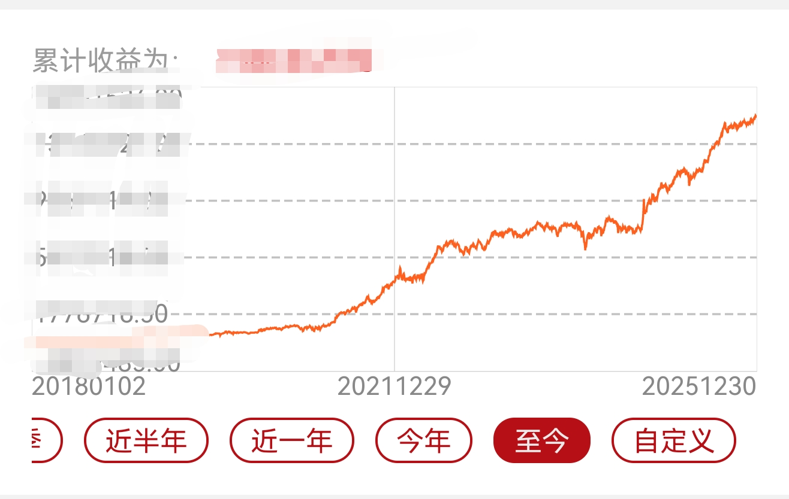

来源：[https://www.jisilu.cn/question/516756](https://www.jisilu.cn/question/516756)

曾经有个朋友看到了卡叔这些年的投资收益图，他惊讶的问：“卡叔，你到底是怎么做到如此平稳又高速的收益率的？是因为帅吗？”
一向谦虚的卡叔立即否认了他的说法。在认真思索后，卡叔还是答复了他的问题。卡叔说：“我觉得吧，我有这样的收益率，可能和我除了帅以外的几十项优点中的某几项有关。
”截至2025年12月31日，卡叔的本年度收益为36.68%，虽然今年这个收益率和很多优秀的股票投资者无法相提并论。但是对于偏重低风险品类的卡叔来说，我自认为是相当不错的成绩了。
如果从2014年算起，截至2025年12月31日，在长达12年的周期里，卡叔的股市资产合计取得了超过18倍的增值。
而拉开我的历史收益图，不管是历史收益还是当年收益，收益曲线都是一条缓慢向上的曲线。

股市是一个充满传奇的地方，我们时不时的会听到某些投资者的故事，在几年时间里得到了多少万倍投资收益的神话，对于这些奇迹，卡叔从来不质疑这种收益率的可能性。但是我们也应该知道，神奇的收益率只是属于少数天赋型投资者，甚至需要一些幸存者偏差来实现。
而大部分普通投资者呢？或许采用卡叔这种小碎步、滚雪球的方式，才是相对容易复制的模式。投资多年，卡叔一直认为自己的投资模式，证实了普通人也可以通过资本市场实现资产的阶级跨越，这里并不是一个只能需要运气，需要靠人脉，需要各种所谓的内幕才能改变人生的地方。和多数投资者凭经验判断做投资的方式不同，低风险投资对标的物选择有更强的逻辑，更精确的价格估值和持有时间的判断。
卡叔也希望以今年的投资做案例，来总结来分享一些自己的投资观点。也期待多数普通投资者有些启发。
卡叔对股市的理解有哪些呢？
第一：低风险并不等于低收益。
经常有投资者听到低风险投资就很不屑。总觉得这种苦熬很久但是盈利有限的模式会白瞎了行情，会使得他们错过发家致富的机会。但是我认为，他只是完全不懂低风险投资的精髓而已。
以卡叔的持仓为例，主要由股票、基金和转债组成，其中七成以上持仓是可转债持仓，且以中低价转债为主。
这样的组合是如何体现低风险的？
首先占据高比例仓位的可转债，是一种防守属性很强的投资品种，我的买入成本一般以债券到期本息价格作为参照物，且看重可转债的到期还本付息能力。所以，如果遇到市场的阶段性回撤，我持仓的债券属性就会体现价值。我的绝大部分转债都能实现盈利，如果不考虑大幅震荡行情中，我主动性轮动去性价比更高品种造成的损失。我的持仓的可转债的投资胜率超过95%。
（备注：主动性轮动造成的损失是指：在市场低迷时，将一些债性突出，持有到期必然盈利的品种，亏损卖出轮动到同样有债性保护，但是弹性更大的品种上，当然这种轮动造成的损失绝对值是非常有限的。）
其次：我持仓的可转债，分散在60到80个品种之间，即便是我相对重视的品种，单品持仓也很少有超过5%比例。这样的组合使得我在单品遇到基本面出现重大变化的黑天鹅时，也不会有重大的总资产回撤。
这样的组合的收益率到底如何？
与不会发生重大回撤对应的是，我的组合也不会出现短期大幅度的增长。
我们以实际的案例来做一次分析，今年卡叔最高的收益来自金陵转债。这是我本年度唯一持仓接近10%的品种，单纯从数据和规则上看，高溢价的金陵转债，貌似并不是一个具备爆发性的品种。但是在去年我的主力建仓区域在115元左右，金陵转债的到期收益率高达3.5%以上。这也预示着，在没有违约的情况发生时，我的转债持有到期，保底可以获得超过银行理财的收益。
而金陵转债是一个迷你转债，历史上被游资一次拉到170元以上，一次拉到200元以上。所以它是一个存在很多可能性的可转债。
对于现金流尚可，负债率不高的企业，上市公司也不排斥下修，标的随时可能转守为攻，我认为这就是一个值得上一定仓位的低风险机会。
而到了六月，金陵转债的正股搭上了苏超的热度，转债价格甚至一度拉到217元。格局不够的卡叔在150-160元区间获利了结大部分仓位，最终这个防守性很强的标的带给了我接近3%的整体收益。
在大A，很多投资者的体验并不好，在长达十年的时间里，股市的指数一直在3000点附近上上下下的波动。但是市场的阶段性行情，依然会在一定的周期里反复出现。如果我们持仓着向下空间有限的投资品种，反而容易在这样震荡的行情不断寻找到变现和回补的机会。喜欢买股票的投资者，可能对半个点一个点的收益没有感觉，但是对于低风险投资者来说，这种持续缓慢向上低回撤的收益率就是一种常态。在复利的加持下，则会叠加出相当让人惊艳的收益率。
以卡叔为例，自2014年至今，卡叔的总资产平均不到三年就向上翻一倍。在过去的十一多年的时间里，只有2018年没有取得正收益，但是总资产亏损也只有0.5%。
第二：高仓位绝对不等于高风险。
在过去十年的绝大部分时间里，我都保持着满仓甚至杠杆的水平，即便在今年指数创下十年高点的背景下，我也没有太过度的低仓位运行，直到下半年才分流资金去打新北交所。我认为，很多人把仓位控制等同于风险控制本身就是一种错的离谱观点。而不敢高仓位运行的后果就是导致即便遇到牛市，也只能在市场里赚点小钱结果。甚至很多投资者在指数低位保持克制，在市场火热的时候，反而自信心爆棚，直接大仓位追加进去，这才是真正风险所在。
所以，我认为，想要实现总资产的快速平稳增长，那么仓位和策略就不能同时保守，有且只有一个要进行激进操作。
因为如果仓位和策略同时保守，通过投资跨越阶级的梦想就难以实现，股票投资大概率只能带给你赚小钱的快乐。而如果仓位和策略同时激进，这样的投资就是高风险的博弈，如果只是一个投资认知普通的投资者，很有可能输的倾家荡产。
所以有两种可能实现资产稳健向上的投资模式，要不就是控制仓位做激进策略。要不就是卡叔这种重仓投入，做低风险投资。
但是我们应该持仓以什么样的品种，能既满足高仓位又在持有的过程中不焦虑呢？
卡叔是如何做的？
首先，细分可转债的防守等级。
我会计算出一个可转债的底线价格和当前价格的差值。比如还有半年到期的浦发转债，我认为年化2%的到期收益率就是它下跌的极限位置。那么到期本息为110元的浦发转债，我认为其距离到期本息的最大差值约为110*0.5*2%=1.1元。也就是108.9元。如果当时浦发转债的价格为109元，则底线价格和当前价格差值为0.1元。
同样的计算方式，金陵转债的到期时间为2027年1月19日。那么在2025年1月15日。到期本息为126.5元。如果按照3%计算到期收益率。底线价格约为120元。而1月15日的交易价格为123.39元。则底线价格和当前价格差值为3.39元。
可转债的底线价格和当前价格的差值的数据代表着什么呢？我理解就是在基本面没有出现黑天鹅的情况下，该转债在当前时间点下跌的最大值。这个差值越小则防守性越好，越大则防守性越差。
有了这个数值后，我们可以参考出标的防守性，然后我们再评估出标的向上波动的可能性。从而作为配置持仓的标准。
但是需要注意的是，一般来说，标的的防守性和攻击性往往是负相关的。也就是说数值越小的标的，往往也代表着弱攻击性。所以并不是数值越小的标的，代表着越值得配置。去思考如何利用这个数据去配置攻守平衡的标的才是我们需要注意的。
计算完数据后，我们再回到问题，我们如何保持高仓位又在持有的过程中不焦虑呢？
我们根据自己的风险承受能力去选择不同的仓位。对回撤承受能力高的投资者，选择回撤可能略多，但是向上攻击性较高的标的。比如金陵转债。而对回撤更在意的投资者，可以加大绝对防守性仓位的比重。比如把更多仓位用浦发转债做现金替代。
但是我们需要注意的是，可转债是一个期权价值很高的债券品种，它和纯债以及货币基金类的防守性完全不同。以卡叔为例，3月时，随着市场的热度提升，可转债估值也跟风走到了一个相对鸡肋的位置。面对明显高于可转债历史均值的估值水平。卡叔也在雪球发文推荐浦发转债作为现金替代。当时还有半年多时间到期的浦发转债，年化收益率已经到达1.8%，卡叔认为向下空间极其有限，但是市场普遍不好看它，认为银行股波动小，难以收缩溢价。但是随后银行板块回暖也带给了浦发转债机会，到了7月浦发转债价格到达了114到115元区间。虽然看起来这笔投资的绝对收益并不高。但是持有期并不长，这样超强防守性的转债，取得20%的年化收益，当然是满意的收益。
第三：追求主动性亏损
因为可转债具备还本付息的属性，很多可转债投资者都习惯持仓出现浮亏，就坚持持有。直到债性出现获得正收益为止。可是投资很重要的原则就是忽略成本。
我们需要随时随地在当下的时间点去评估标的价值，我们不能以是否亏损作为持有的理由，我们的持有的理由一定是“标的当前性价比是否最高。”对于特别容易量化的可转债，亏损不轮动的行为，会造成收益率损失。这种行为就好像你看上了一个姑娘，追了她三年，但是她一直对你不冷不淡的。这时候，你生命中出现了一个样貌、身材、经济条件比她要强的姑娘，对你还热情的很，可是你却拒绝了她，还要不抛弃不放弃原有的选择，因为“接受了她，前三年的追求就白努力了。”这显然是错得离谱的行为。
24年初的时候，可转债遭遇一次集体的重创。在可转债底部我减仓了一些债性很高的转债。
比如：评级高所以下跌幅度不大的希望转2、天23、恒逸转2。
质地安全的但是溢价略高的道恩和开润转债。
临期波动范围小的岩土转债。
质地不佳但是下跌有限的文科转债、美锦转债。
始终不下修，董事长头铁的可以砸核桃的好客转债。
而我买入的则是下跌幅度巨大，未来价格潜力很大，但是当时价格已经具备防守性的海波转债、迪贝转债、飞鹿转债、今飞转债、智能转债、泰林转债、斯莱转债、润禾转债、联创转债、联诚转债、锋龙转债。
这些转债当时的特征都是具备足够的债性。溢价率尚可，流通盘较小，历史波动大，大部分质地安全。也正是这次难得的换仓机会，使得本来攻击性不佳的持仓，活力大增。这些持仓也是2025年盈利的主力军。
而2025年4月7日，特朗普发起贸易战的时刻，也是今年难得的调仓和加仓的机会。卡叔也陆续买入到期正收益附近的锦鸡、海泰、纽泰、宝莱、华正、佳力、小熊、富仕、章鼓、再22、明电转02等转债。在后续的行情，这些转债也证明了他们既有防守性也有攻击性。
第四：尊重市场的一切可能。
卡叔曾经发过一个贴，我说市场的游资拉升迷你市值的可转债是有规律的，比如三力转债，每隔几个月都会借助正股涨停，同步拉升一次可转债联动。我说我认为操盘这只转债的应该是同一批游资，因为他们都是开盘上冲，在10点多冲出高点，上午收盘时走出一定幅度的回撤，下午在2点附近拉升到当日新高，尾盘跳水，第二天开盘继续跳水，结果一波行情。我说三力转债这样的走势一年会出现好几次，而不同的转债，如果仔细的观察可以发现，每个市场主力都有不同操作手法，又比如东时转债，会在一个时间周期里喜欢小碎步进二退一的向上拉升出空间。然后在发力急冲后，忽然走出断头杀行情，甚至持续出现瀑布式调整。
卡叔发完贴，有投资者很愤怒，他表示要拉黑卡叔，他觉得卡叔作为一个有点影响力的投资者，不去分析可转债的质地，而去强调一些完全和价值投资无关的内容就是不对的。
但是卡叔想说的是，我们来自资本市场，最重要的一点就是，我们来这里的目的就是为了盈利。我们并没有能力对市场指手画脚，如果市场简单到可以按照我们从书本学习的正统知识去投资，那赚钱会不会太容易呢？所以，即便我们可能不擅长一些盈利的模式，甚至会刻意回避一些盈利的模式。但是我们需要尊重市场中任何一种投资模式。我们需要知道，投机能赚钱，买垃圾股能赚钱，买违约预期债同样能赚钱。当我们太过狭隘的时候，我们才会以自我为中心，去站在制高点去评判其他的盈利模式。
在市场里面，我们把自己放的越低，我们越可以看穿盈利的机会。我们当然不是让自己的投资策略和这些策略产生并集，我们只是去寻找自己策略和其他难以理解策略的交集。市场的一切行为都应该为我所用，在低风险的原则下，我们可以更多的关注到迷你市值转债高波动的特征，我们可以用价值投资的理念去精选标的，我们跟着题材的风口去增强短期收益。我们容纳各种形式的知识，但是不应该被带着跑偏，只要核心依然以保本付息作为投资原则，那些奇奇怪怪的，甚至非常不理性的操作模式就会变成我们的收益加成。
第五：以历史数据作为参照，熟悉规则跑赢指数。
分析最近五年多的收益，卡叔的收益和集思录等权指数是非常贴合的。
可转债等权指数历年来涨幅是多少呢，2019年27.97%，2020年23.26%，2021年35.61%，2020年-6.5%，2023年1.54%，2024年4.3%，2025年截至10月31日为24.29%。
而卡叔同期的收益率是2019年39.92%，2020年32.55%，2021年46.24%，2022年16.66%，2023年11.61%，2024年26.5%。2025年为36.68%。
可以发现每年卡叔大约跑赢可转债等权约10-20%之间。指数涨幅较低的年份，跑赢指数越多，而指数涨幅高的年份则跑赢的幅度较低。今年由于指数偏高，卡叔没有像往年一样，全年满仓轮动，所以跑赢的百分比也是历年来相对低的一年。
可转债作为一个兼具债性股性的投资品种，在下修这个中国独有的BUG条款加持下，造成了风险的不对称，它成为近年来低风险投资领域，很受关注的品种。
我们需要了解哪些数据和信息呢？从而设立出当前的可转债操作策略呢？
第一：自2017年，宝信转债开始的可转债信用发行，共计504只可转债退市。平均上市首日收盘价为115.34元，而最后一个交易日的价格为152.14元，平均存续期为2.97年。也就是说目前已经退市的可转债，平均在它完整存续期内，给投资者带来36.8元的收益，约31.9%。
第二：截止10月31日，宣布强赎的可转债，公告日前收盘价平均为165.42元，公告日开盘价平均价为160.69元，平均下跌4.73元。最后交易日平均价为154.73元，平均下跌为10.69元。
第三：由于可转债发行半年内，大股东无法减持，所以在市场较热时，次新转债，尤其是小市值次新转债的估值明显高于合理水平。但一般在解禁后，慢慢会回归合理估值。如果一波市场整体的较大级别调整，有助于次新转债快速回归合理估值。
第四：集思录可转债等权指数的编制规则是什么？这个指所记录的完整周期是每一只转债上市的第一天收盘价到最后一天退市的价格。指数剔除停牌的转债，复牌后再重新加入；上市第二个交易日加入，退市剔除。指数不计入利息。
可以观察到，少部分可转债首日收盘价格为涨停价157.3元，实际上现实中不能买入，造成指数高估，但这种现象不普遍，而未计入利息造成指数低估则更普遍，使得这个指数实际被低估。但是它每日动态平衡的仓位，使得投资者尤其是资金量较大的投资者，难以跟踪。反而是中小投资者依据它编制特征容易跟踪出相应的投资者策略，即分散、轮动的投资模式。
而卡叔基于上面三项的历史数据特征和指数编制规则，可以设置的跑赢方式有如下。
1、回避次新转债，等待估值合理。
2、回避强赎债，一般来说，卡叔会在计算强赎日5天后，逐步卖出，除非溢价水平过低。否则不会等到公告日前夕，计算强赎日最后几日，一般期权价值明显降低。
3、信用发行后，强赎比例有所降低，有相当部分的上市公司选择不强赎，但是临期近的可转债，上市公司强赎的意愿更强。所以，卡叔跑赢指数的很重要原因，就是我没有百分百的复制指数走势，我把指数编制的规则里，可能负收益的时间，即次新周期和强赎周期都予以了回避，从而获得了增强收益的效果。
备战2026年，低风险投资应该如何做？
2025年10月，大A站上4000点，这是A股十年的新高，但是同时也造成了未来低风险投资的更高难度。我认为市场已经出现了变化，类似熊市既安全又有攻击性的标的基本不再存在了。所以，在市场不上不下的状态下，我有如下的想法：
1、如果市场持续在估值较高，我会持续保持一定量的资金参与北交所打新。2026年，若指数继续走高，则不追求跑赢等权指数。如果市场热度持续，则市场可能出现更多套利的机会，发掘新的低风险机会补充可转债估值高带来的风险。
2、对比2007年和2015年牛市，2025年的市场处于热而不疯的状态。所以可转债市场整体并未出现以前牛市中疯狂泡沫的状态。至少当前的市场中依然有贴近到期本息价格的转债可以轮动。
3、前两波牛市末期，可转债大批量强赎，最终导致存量转债价格出现巨大泡沫。而如今的市场，可转债发行量远高于以往，且有相当数量的上市公司选择不强赎，使得场内存量不至于出现以往牛市末期极度稀缺的状态，所以疯狂泡沫的价格应该难以再现。只是随着可转债发行量减少，强赎、转股和到期转债数量依然不断增加，曾经过万亿规模的市场，当前存量5300亿。可以预见市场存量在2026年依然会进一步减少。即便市场难以进入疯狂状态，但是市场进一步抢筹依然可能推高市场估值。
2026年我将回避如下转债：
第一类：半年以内到期尤其是三个月以内到期，且负收益较多的可转债。这类转债，期权价值会在短时间内快速缩水。
第二类；转债价格超越强赎线过多，但是溢价明显的大市值高评级转债。这类转债，如果正股上涨，则可能导致转债触碰强赎线，从而使得溢价变小，最终使得正股上涨转债横盘，正股暴涨转债强赎，会严重跑输正股，这类转债表现相对鸡肋。
第三类：一年以内到期的双高（高价高溢价）小市值转债。这类转债，面临估值大幅下跌的风险。
第四类：明显高估的次新转债。在5%以上股东配债解禁后，择机进入。
第五类：质地不佳的转债。当市场转向时，此类转债债底很不扎实。
2026年我将关注的转债：
第一类：小市值高溢价距离保本位置不远的可转债从攻击性的角度，可转债当然是溢价率越低越好。但是在当前的时间点，低溢价小市值几乎不可能买到合理的价格了，所以小市值高溢价是不得已的选择。而买入的想法是，下修的可能会改善高溢价率。如果市场存量进一步变小，存量迷你债可能爆发。
第二类：绝对防御，低期权价值、质地安全的临期债。2025年浦发转债一度在正收益价格附近徘徊，实际上一旦进入3个月以内的临期状态，多数有一定溢价的转债都可能出现保本价格以下的价格。虽然这些转债多数都会以低于保本价0.1元左右退市，但是只有期权费用够低，就值得我们去博弈一个可能性。
第三类：存续期略长，但是大股东未减持的转债历史经验来看，由于重要股东未减持转债，他们往往为了卖出更好的价格，则更有可能出现先下修再减持的操作。
第四类：存续期在2年附近的可转债以往的操作中，我一直会倾向买入2年附近的可转债，原因是这些存续期没有短到期权价值很低，但是又没有长到上市公司对解决债务无所谓的状态。一旦上市公司开始重视转债促转股问题，即便高溢价也随时可能反守为攻。
始于2024年9月的这轮牛市，已经持续了一整年，即便我看好国家经济的长期韧性，即便我认为市场可能出现更火热的局面。但是我们不可否认的问题是房地产市场回落带来的隐忧解决还需要时间，不友好国家阻止中国崛起的想法不会变，A股部分上市公司质地本身就没有好，所以，越是火热越是震荡的格局也不会变，但是对我们低风险投资者来说，只要我们能评估标的精准估值，市场的波动对我们来说就不是问题，而是好的调仓机会。
最后的话：
最近一年，因为资本市场表现还不错，所以我反复听到了一些言论，既然市场那么好，为什么我们还要坚持低风险投资呢？为什么可转债的风险也在累积，还要坚持在可转债上呢？
可是我想说的是，大部分普通投资者都应该接受一个现实，那就是市场中可以短期实现爆发性增长的投资者，且能全身而退的投资者，永远都是极少数。急功近利并不是普通人实现家庭资产增长的稳定途径。觉得低风险的可转债变的有风险，就采取是去买更高风险股票的策略，显然是更不靠谱的做法。
作为普通投资者，在投资之前，要想清楚的一件事，那就是我们投资的目的是什么？如果只是钱生钱？赚更多的钱？那么我们就辜负了财富的价值，也更加容易被贪欲所控制。
我们应该知道，财富可以让我们生活过的不拮据，财富可以让我们不去妥协生活中本不需要妥协的事情，财富可以让我们在家人遇到困难时挺身而出。当我们想清楚的了财富的意义，才会更认真的对待获取财富这件事，才会不把投资理解成赌博的另外一种形式。
理解投资慢就是快，理解投资积小胜求大成，接受滚雪球的意义，才是普通人投资真正的起点。
